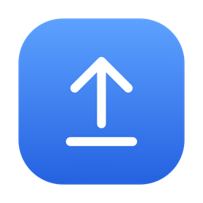
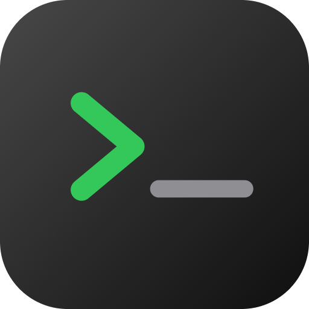
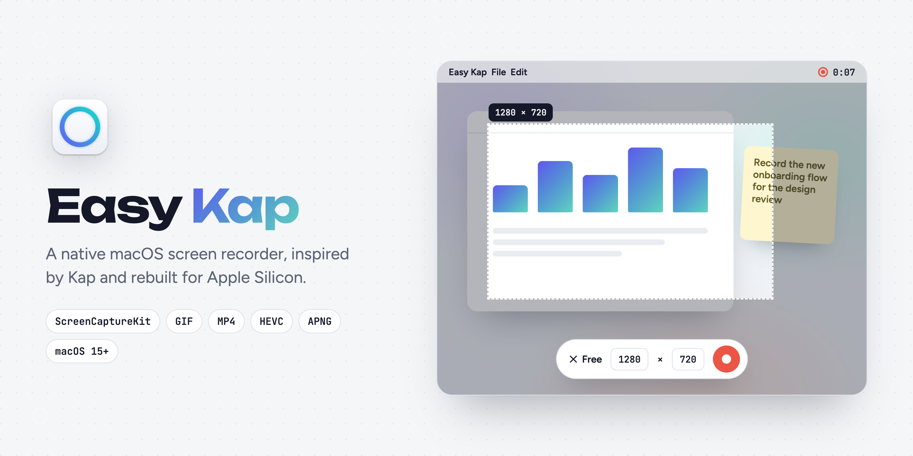
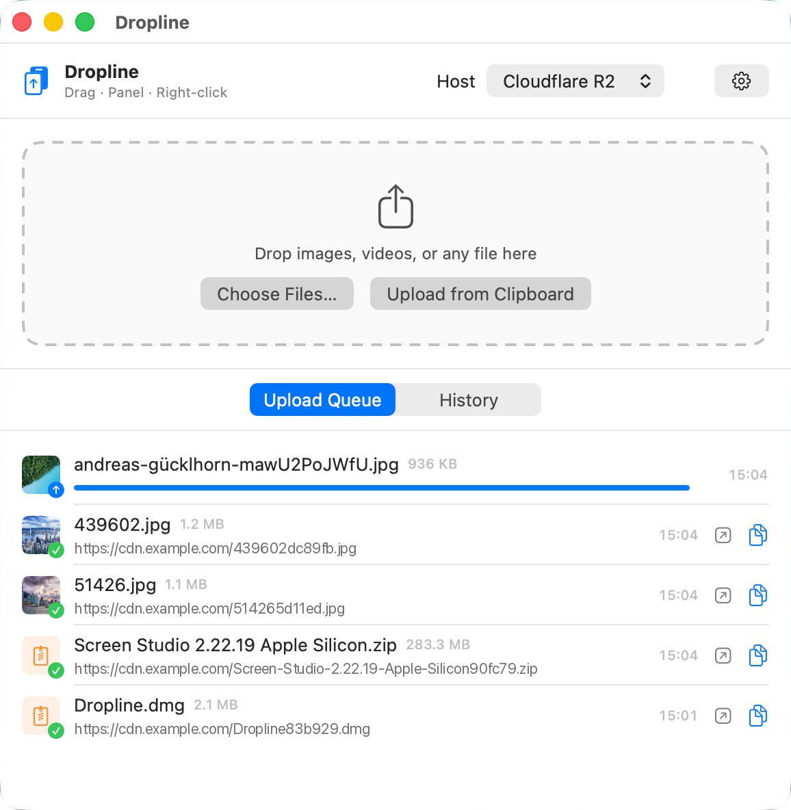
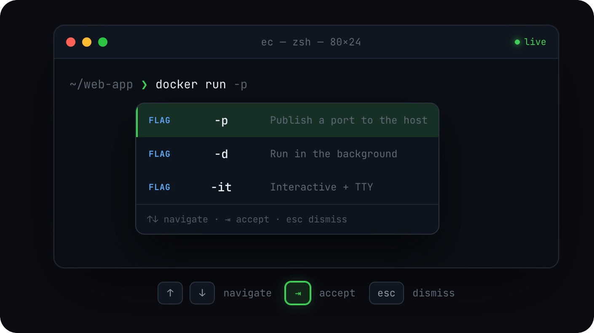

# Homebrew Tap

Homebrew casks for my macOS apps.

```bash
brew tap chen86860/tap
```

| | App | What it does | Install |
| :-: | --- | --- | --- |
|  | [Easy Kap](#easy-kap) | Native screen recorder inspired by Kap | `brew install --cask chen86860/tap/easy-kap` |
|  | [Dropline](#dropline) | Uploads any file to your own host and copies the link | `brew install --cask chen86860/tap/dropline` |
|  | [Easy Complete](#easy-complete) | IDE-style inline autocomplete for terminals | `brew install --cask chen86860/tap/easy-complete` |

## Easy Kap

[Easy Kap](https://github.com/chen86860/easy-kap) — a native macOS screen recorder in Swift, inspired
by Kap. Record an area, a window or a whole screen, trim it, and export GIF, MP4 (H.264 or HEVC) or
APNG, with no Electron and no bundled ffmpeg.

<p align="center">
  
</p>

```bash
brew install --cask chen86860/tap/easy-kap
```

Easy Kap requires macOS 15 Sequoia or later and runs natively on Apple Silicon and Intel. The app is
signed with a Developer ID and notarised, so it opens like any other app; record once and allow
Screen Recording when macOS asks.

Easy Kap updates itself through Sparkle, so there is no need to `brew upgrade` it. The cask tracks
`releases/latest` and therefore carries no version number.

## Dropline

[Dropline](https://github.com/chen86860/dropline) — a native macOS uploader: drag & drop,
right-click in Finder or use the menu bar to send any file to your own host, and the public
URL lands on your clipboard.

<p align="center">
  
</p>

```bash
brew install --cask chen86860/tap/dropline
```

Dropline requires macOS 13 Ventura or later on Apple Silicon.

The build is ad-hoc signed rather than notarised, and Homebrew quarantines whatever it
installs, so clear the flag before the first launch:

```bash
xattr -dr com.apple.quarantine /Applications/Dropline.app
```

Dropline updates itself through Sparkle, so there is no need to `brew upgrade` it. The cask
tracks `releases/latest` and therefore carries no version number.

## Easy Complete

[Easy Complete](https://github.com/chen86860/easy-complete) — an IDE-style inline autocomplete
app for macOS terminals.

<p align="center">
  
</p>

```bash
brew install --cask chen86860/tap/easy-complete
```

Easy Complete requires macOS 12 Monterey or later on Apple Silicon.

## Uninstall

```bash
brew uninstall --cask <name>        # remove the app
brew uninstall --zap --cask <name>  # also remove its settings and caches
```
